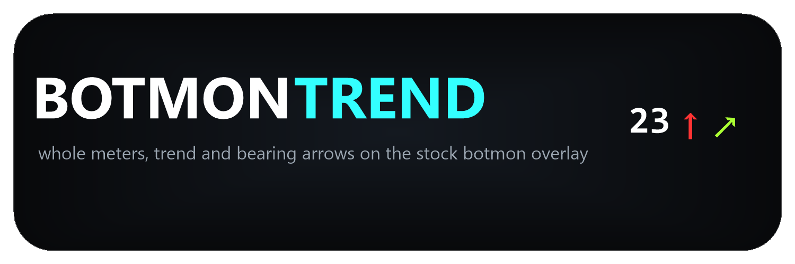

# Botmon Trend

A client-side mod for SP Tushonka 4.1.6 (BepInEx). It reworks the stock `botmon` overlay: whole meters
measured from **your player**, a distance trend arrow, yellow brackets around nearby bots, an
eight-direction arrow showing where each bot is moving relative to where you look, and **the whole
list sorted nearest-first** — the most dangerous bots on top.

```
Stock:  Zone = 3
        > [42.13m] [assault] [Savage] [normal] Kaban
        > [8.00m]  [assault] ...
        > [15.50m] [watchdog] ...

Mod:    ◈    [↓8m]  [Savage]        ← nearest first
        ↗ ◇ [↑16m] [Bear]
        ↗ ∘ [↑42m] [Savage]

           ↑ green — the gap is growing
           ↓ red — the gap is closing
           no arrow — the distance is steady (or set your own marker, e.g. "=")
           ↗ — the bot moves ahead-right relative to your view
           ∘ common bot, ◈ boss (red), ◇ escort/cultist (orange)
```

The console command is the same: `botmon 1` / `botmon 0`.

## Features

- **Distance trend** — a green arrow when the gap grows, a red one when it closes. The trend is
  computed from live bot positions, so the arrow also reacts when only you move.
- **Nearest-first sorting** — one flat list, closest bot on top. A hysteresis band keeps two bots
  at about the same range from swapping places every frame.
- **8-direction bearing arrow** — where the bot goes (or stands) relative to your look direction,
  in eight 45° sectors:
  ```
          ↑ (ahead)
     ↖         ↗
  ← (left)       → (right)
     ↙         ↘
          ↓ (behind)
  ```
  Two sources: `Movement` shows where the bot walks (the heading is latched until the distance
  changes, so a standing bot keeps its last known direction), `Position` shows where the bot is
  around you, refreshed every frame.
- **Rank markers** — the stock `>` prefix becomes a rank badge: a boss (role starts with `boss`),
  his escort (`follower*`) or cultists (`sectant*`), colored red / orange / white. Any glyph can be
  replaced from the settings.
- **Proximity highlight** — the `[distance]` brackets take a separate color while a bot is closer
  than the threshold.
- **Configurable line tail** — keep or drop `[role] [side] [difficulty] nickname` per section.

## Installation

Copy one file into the plugins folder:

```
BepInEx\plugins\BotmonTrend.dll
```

Requires `spt-debugging.dll` (shipped with SP Tushonka). Nothing else is modified: the patch lives only in
the process memory, `spt-debugging.dll` on disk is never touched.

VirusTotal report for the release archive:
https://www.virustotal.com/gui/file/963500a7bc614f053b28c219104a649496a0410bd86a46bf0aef5d7142914017

## Settings (F12 → Botmon Trend)

Sections in menu order: `Distance → Tags → Trend → Arrows → Bearing → Proximity → Debug → About`.
The last one is not a setting: it carries the link to the project page, also written into the
config file.

Glyph styles are two dropdowns instead of many text fields: `Bearing/Style` for the eight
directions and `Arrows/Style` for the trend pair. Picking a preset writes the glyphs into the
individual `N..NW` / `Up`/`Down` entries, which stay in the config file but are hidden from the
menu. If you edit them by hand in the file, the dropdown shows `Custom` and your values are used
as-is.

Colors are compact pickers: a preview swatch, a hex field and five one-click preset checkboxes.
Every value is stored as a plain `#RRGGBB` string in the config file.

Some tunables are intentionally fixed and hidden from the menu (they keep working from the config
file): distance sorting and its hysteresis, the trend window/dead-band/smoothing/confirmation,
the movement-refresh threshold of the bearing arrow and the colored rank markers.

| Section | Setting | Default | Description |
|---|---|---|---|
| Distance | `ShowUnit` | `true` | keep the `m` suffix after the rounded distance |
| Tags | `Role` | `false` | print `[assault]` and the like |
| Tags | `Side` | `true` | print `[Savage]` and the like |
| Tags | `Nickname` | `false` | print the bot nickname |
| Tags | `Difficulty` | `false` | print `[normal]` and the like |
| Tags | `MarkerCommon` | `∘` | line marker for a regular bot, replaces `>` |
| Tags | `MarkerBoss` | `◈` | line marker for a boss (role starts with `boss`) |
| Tags | `MarkerFollower` | `◇` | line marker for escorts and cultists (`follower*` / `sectant*`) |
| Arrows | `Colored` | `true` | paint the arrows with rich text; turn off if the tags show up literally |
| Arrows | `Style` | `↑ ↓` | trend glyph pair: `↑ ↓`, `⇑ ⇓`, `△ ▽`, `▲ ▼`, `▵ ▿` (or `Custom` after a hand edit) |
| Arrows | `Steady` | `◫` | marker for an unchanged distance, e.g. `=`; empty hides it |
| Arrows | `UpColor` | `#33FF66` | color of the "gap grows" arrow |
| Arrows | `DownColor` | `#FF3333` | color of the "gap closes" arrow |
| Bearing | `ShowBearing` | `true` | draw the eight-direction arrow |
| Bearing | `Source` | `Movement` | `Movement` — where the bot walks (latched); `Position` — where the bot stands around you |
| Bearing | `Style` | `↑ ↗ → ↘ ↓ ↙ ← ↖` | glyph set, clockwise from N; four presets or `Custom` after a hand edit |
| Bearing | `VariationSelectors` | `true` | keep U+FE0F behind emoji glyphs; `false` renders monochrome arrows if emoji show as boxes |
| Bearing | `Color` | `#33FFFF` | color of the bearing arrow (monochrome glyphs only, color emoji cannot be tinted) |
| Bearing | `Elevation` | `true` | tint the bearing arrow by the height difference: bot above you — the up color, below — the down color, otherwise the plain color |
| Bearing | `ElevationUpColor` | `#AAFF33` | color of the bearing arrow when the bot is higher than you |
| Bearing | `ElevationDownColor` | `#FF6B1C` | color of the bearing arrow when the bot is lower than you |
| Bearing | `ElevationThresholdMeters` | `2` | Y difference that counts as a different level; a floor of a panel building is 2.5-3 m, so 2 keeps cars, debris and stair landings in the same level |
| Bearing | `AfterDistance` | `false` | `false` — arrow before the brackets; `true` — after the number, inside them |
| Proximity | `HighlightClose` | `true` | color the brackets while a bot is closer than the threshold |
| Proximity | `CloseDistanceMeters` | `10` | the proximity threshold |
| Proximity | `CloseColor` | `#FFD93B` | color of the brackets for a close bot |
| Debug | `LogMeasurements` | `false` | log measured distance, trend and bearing decisions once per second (`[botpos-diag]`) |
| About | `Repository` | link | project page on GitHub, kept in the config file for reference |

## How it works

- Distances are measured from the local player's position. The value printed by the stock overlay
  is only a fallback when live positions cannot be read.
- The trend compares the smoothed distance with its own value from `WindowSeconds` ago. The
  reference lags behind instead of following the movement, so the arrow also shows up when the bot
  stands still and only you move. Exponential smoothing, a dead band and a few confirmation frames
  keep the arrow from flickering.
- Positions are read once per frame; repeated `OnGUI` passes reuse the same measurement.
- A Harmony prefix captures the player and bot positions from the same collections the stock
  overlay reads; a transpiler reroutes `GUIStyle.CalcSize(GUIContent)` so the panel text is
  reformatted before it is measured and the box keeps the right size.
- Sorting reorders the already formatted lines; unidentified lines and stock counters pass through
  untouched, so a formatting problem can never swallow part of the panel.

## Build

```powershell
dotnet build .\BotmonTrend.csproj -c Release -p:GamePath=<path to your game folder>
```

Output: `bin\Release\net472\BotmonTrend.dll`.

## Limitations

- Requires `spt-debugging.dll` (included in SP Tushonka); without it the mod does nothing.
- Works in a local game with `botmon` enabled.
- The bearing arrow needs live bot coordinates: on the fallback path no arrow is drawn.
- If two bots in one zone share nickname and role, and live positions are unavailable, they share
  one trend state (lines are keyed by zone + line tail).
